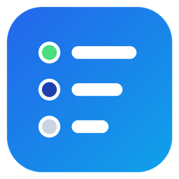

# XDK Suivi

Le logiciel Windows de **XDK TEAM DEV** pour suivre les logiciels XDK : chaque logiciel, sa version et son état
(pas encore traité, prêt à publier, publié, bloqué).

- **Télécharger** : la dernière version est dans [Releases](../../releases/latest) (`XDKSuivi.exe`), ou dans **XDK Hub**.
- Il faut le [.NET 8 Desktop Runtime (x64)](https://dotnet.microsoft.com/download/dotnet/8.0), gratuit chez Microsoft.
- Il faut une **clé** : salon 🔑・demande-de-clé sur le [Discord XDK TEAM DEV](https://discord.gg/zEC35KSuxt).
- Les mises à jour sont automatiques et signées.
